<h1 align="center">Yiğit Efe</h1>

Building developer tools, CLI applications, and systems-oriented software.

  

## About Me

I build practical developer tools, CLI applications, and software focused on solving real engineering problems.

My interests span systems programming, blockchain infrastructure, network monitoring, and modern web development. I care about clean architecture, maintainable code, thoughtful APIs, and shipping software that actually works.

Most of my work is open source. I would rather ship a small tool that runs reliably than a large project that exists only as a demonstration.

## Technology Stack

<picture>
  <source media="(prefers-color-scheme: dark)" srcset="https://skillicons.dev/icons?i=ts%2Cjs%2Cpython%2Crust%2Cbash%2Creact%2Cvite%2Chtml%2Ccss%2Cnodejs%2Cgit%2Cgithub%2Cdocker%2Cvscode&theme=dark" />
  <source media="(prefers-color-scheme: light)" srcset="https://skillicons.dev/icons?i=ts%2Cjs%2Cpython%2Crust%2Cbash%2Creact%2Cvite%2Chtml%2Ccss%2Cnodejs%2Cgit%2Cgithub%2Cdocker%2Cvscode&theme=light" />
  
</picture>

## Projects

- [**chainpulse**](https://github.com/YigitEfe-DEV/chainpulse) — Multi-chain EVM gas price tracker CLI with EIP-1559 fee history and percentile priority-fee sampling; works without API keys.
- [**TokenMaxxing**](https://github.com/YigitEfe-DEV/TokenMaxxing) — Repository intelligence and context optimization toolkit in Rust: duplicate detection, context compression, and prompt optimization.
- [**btc-pulse**](https://github.com/YigitEfe-DEV/btc-pulse) — Real-time Bitcoin network monitor as a dependency-light CLI and TUI: mempool pulse, fee oracle, whale tracker, and network health.
- [**chainguard**](https://github.com/YigitEfe-DEV/chainguard) — ChainGuard, an open-source EVM transaction security and risk analysis SDK for wallets, dApps, and custody.
- [**cross-chain-transaction-simulator**](https://github.com/YigitEfe-DEV/cross-chain-transaction-simulator) — Deterministic, offline-first simulator for visualizing and analyzing cross-chain EVM transaction flows across bridge models.
- [**website-bug-hunter**](https://github.com/YigitEfe-DEV/website-bug-hunter) — Open-source website bug and quality scanner: broken links and images, console errors, redirect anomalies, metadata, and accessibility.
- [**dontneed-dns**](https://github.com/YigitEfe-DEV/dontneed-dns) — Auditable DNS-over-HTTPS resolver and TLS-splitting proxy for networks where DNS queries or the TLS handshake are blocked.
- [**matlab-lab**](https://github.com/YigitEfe-DEV/matlab-lab) — Local-first MATLAB learning site: summary notes from course slides, 100 auto-graded exercises, and real code execution with error diagnostics; dependency-free via Python stdlib and GNU Octave.
- [**DevToolKit**](https://github.com/YigitEfe-DEV/DevToolKit) — All-in-one developer toolbox built with React and Vite: JSON utilities, generators, converters, and validators.
- [**smart-to-do**](https://github.com/YigitEfe-DEV/smart-to-do) — LumaFlow, a React task workspace with local persistence, filtering, global search, and a statistics dashboard.
- [**CalcSnake**](https://github.com/YigitEfe-DEV/CalcSnake) — Scientific calculator with memory registers, persistent history, and a hidden Snake game.
- [**YigitEfe-DEV.github.io**](https://github.com/YigitEfe-DEV/YigitEfe-DEV.github.io) — Published build of my personal site, efeyigit.me, served through GitHub Pages.
- [**YigitEfe-DEV**](https://github.com/YigitEfe-DEV/YigitEfe-DEV) — This profile repository: README, neural network animation, and the generator that produces it.
- [**merkle-tree-visualizer**](https://github.com/YigitEfe-DEV/merkle-tree-visualizer) — Fork of berkturan-coder/merkle-tree-visualizer: builds Merkle trees and generates and verifies proofs.
- [**skills**](https://github.com/YigitEfe-DEV/skills) — Fork of mattpocock/skills: a collection of agent skills for engineering workflows.
- [**StickPick**](https://github.com/YigitEfe-DEV/StickPick) — Fork of AvishkarPatil/StickPick: converts Telegram stickers for WhatsApp.
- [**awesome-n8n**](https://github.com/YigitEfe-DEV/awesome-n8n) — Fork of tysoncung/awesome-n8n: community nodes, templates, and hosting guides for n8n automation.

## Connect

  
  &nbsp;&nbsp;
  
  &nbsp;&nbsp;
  

